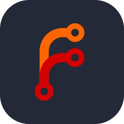
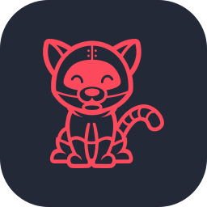

<div align="center">


</div>

```console
frizzay@homelab:~$ whoami
timo  # but the internet knows me as Frizzay

frizzay@homelab:~$ cat /etc/motd
I'm a platform engineering consultant (that means I get paid for talking).
Building highly available cloud native platforms is my passion.
Ever since I was a small child, I knew I wanted to increase shareholder value.
```

## 🧬 `kubectl get human frizzay -o yaml`

```yaml
apiVersion: humans/v1alpha1     # still in alpha, breaking changes expected
kind: PlatformEngineer
metadata:
  name: timo
  labels:
    alias: frizzay
    habitat: homelab
    club: hertha-bsc            # hahohe 💙🤍
spec:
  replicas: 1                   # horizontal scaling blocked on cloning tech
  languages: [german, english, yaml]
  favoriteTools: [ansible, docker, kubernetes]
  restartPolicy: OnTea
  livenessProbe:
    exec:
      command: ["cat", "/dev/tea"]
    periodSeconds: 3600
status:
  phase: Running
  conditions:
    - type: Ready
      status: "True"
      reason: CaffeineLevelsNominal
```

## 🐳 Projects

| Project | What it does |
| --- | --- |
| 🔄 [**dnf-auto-setup**](https://github.com/Frizzay/dnf-auto-setup) | Ansible role for hands-off Fedora updates with `dnf5 automatic`. A report lands in Discord after every run, so I find out about reboots before my users do. Comes with an interactive playbook, so you don't have to write any YAML. |
| ⚽ [**hertha-cal**](https://github.com/Frizzay/hertha-cal) | A subscribable ICS calendar with every Hertha BSC competitive match, with reminders 30 and 5 minutes before kickoff. |
| 🤖 **FrizzBot** | A private Discord bot for music, levels, polls and moderation. |
| 🏠 **The homelab** | It's never finished, and that's the fun part. |

## 🧰 Toolbox

<p align="center">
  
  
  
  
  
  
  
  <br />
  
  
  
  
  
  
  
</p>

## 📟 Changelog of my life

```diff
+ automated: server updates, deployments, Discord notifications, my own laziness
+ containerized: pretty much everything that holds still long enough
- not yet automated: making tea (PRs welcome)
- known issue: "just a quick change" in the homelab takes the entire weekend
```

```console
frizzay@homelab:~$ exit
logout
Connection to frizzay closed. Thanks for stopping by! ✌️
```
